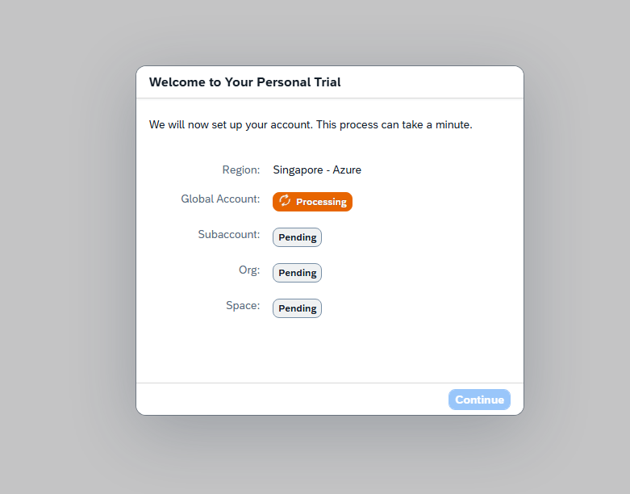

# Create SAP BTP Trial Account

## Reference

SAP Tutorial:
https://developers.sap.com/tutorials/hcp-create-trial-account

---

## Step 1: Open SAP BTP Trial Page

Search/Navigate to SAP BTP Trial Account page:

https://www.sap.com/products/technology-platform/trial.html

Click **Try Now**.

---

## Step 2: Sign Up/Sign In -> Accept Terms and Conditions

Log in to SAP account. You can sign in with your registered email address or SAP User ID, e.g. **P-user**, **S-user**, **C-user**, **D-user**, or **I-user**, with associated password.

If you do not already have an SAP account, click **Register** and follow the registration process to create a new user account.

---

## Step 3: Select Region

Create a subaccount hosted in available geographic region. Choose any region and click Create Account

---

## Step 4: Provisioning in Progress

SAP will create the trial account and provision the environment.

---

## Step 5: Access SAP BTP Cockpit

After provisioning completes, the SAP BTP Cockpit home page is displayed.

---

## Result

Your SAP BTP Trial Account has been successfully created and is ready for use.
