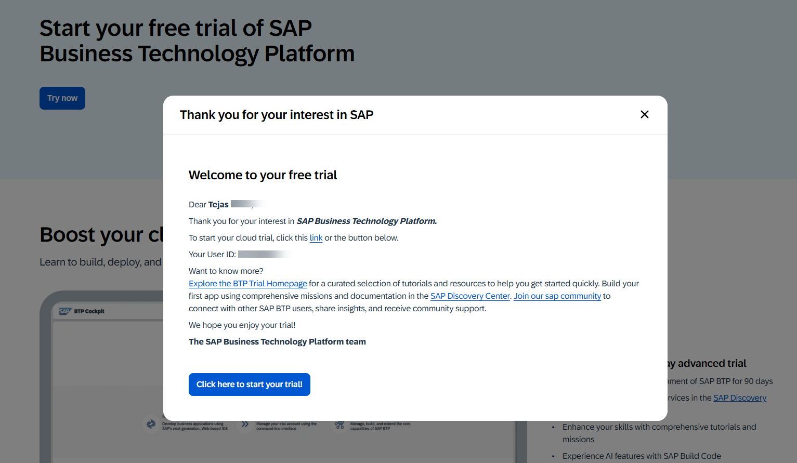
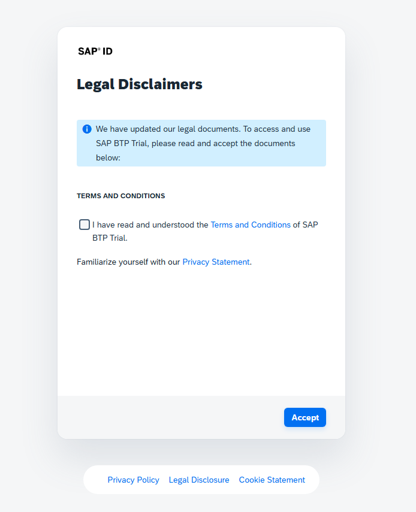
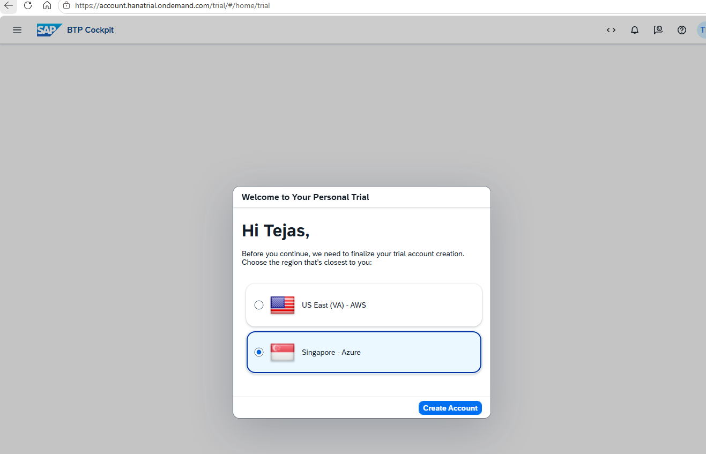
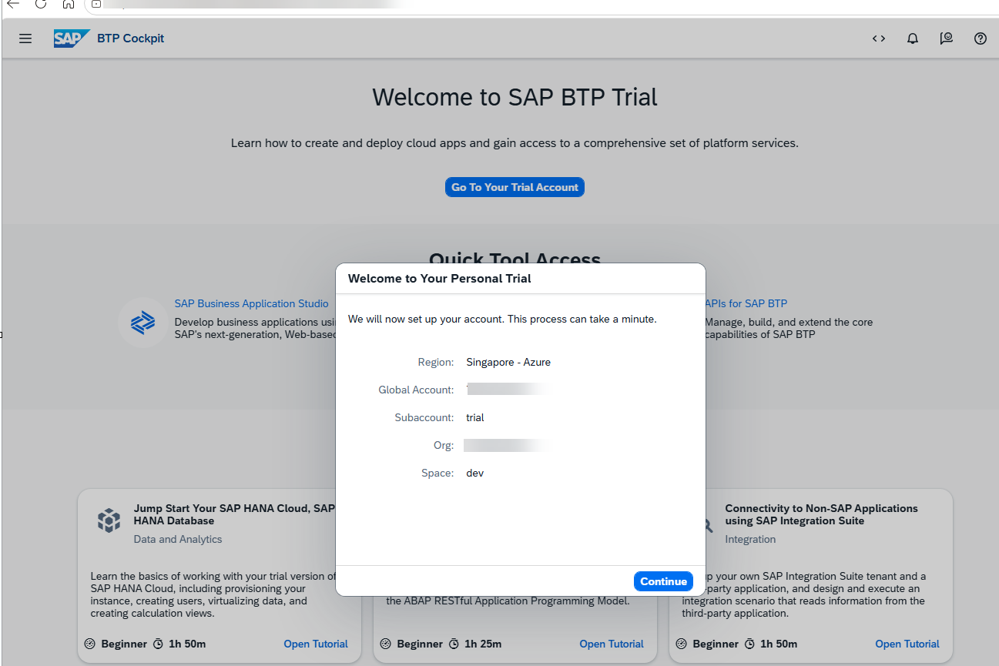

# Create SAP BTP Trial Account

This guide explains how to create a free SAP BTP Trial Account and access the SAP BTP Cockpit.

## Reference

SAP Tutorial:
https://developers.sap.com/tutorials/hcp-create-trial-account

---

## Step 1: Open the SAP BTP Trial Page

Navigate to the SAP BTP Trial website:

https://www.sap.com/products/technology-platform/trial.html

Click **Try Now** to begin the registration process.

---

## Step 2: Sign In or Register

Log in using your existing SAP account credentials.

You can sign in using your registered email address or SAP User ID, for e.g. P-user, S-user, C-user, D-user, I-user

If you do not already have an SAP account, click **Register** and complete the registration process.

Review and accept the SAP Trial Terms and Conditions before proceeding.

---

## Step 3: Select a Region

Choose the region where you want your trial subaccount to be hosted.

Select any available region and click **Create Account**.

---

## Step 4: Wait for Provisioning

SAP will start creating your trial account and provisioning the required resources.

The account setup process may take a few minutes.

---

## Step 5: Access SAP BTP Cockpit

Once provisioning is complete, you will be redirected to the SAP BTP Cockpit.

You can now access your Global Account and Trial Subaccount.

---

## Result

The SAP BTP Trial Account has been successfully created and is ready for use.
