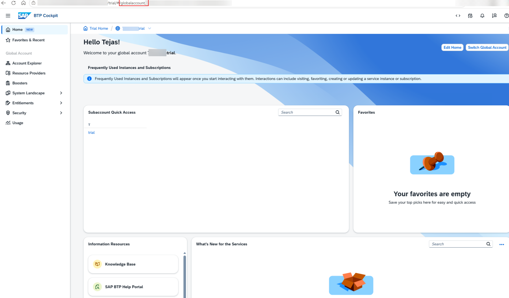
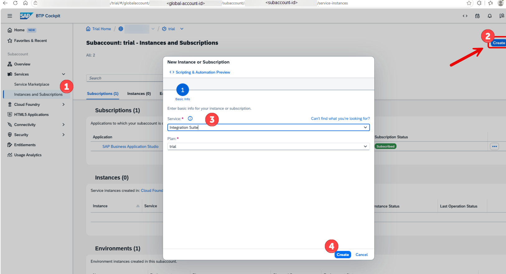
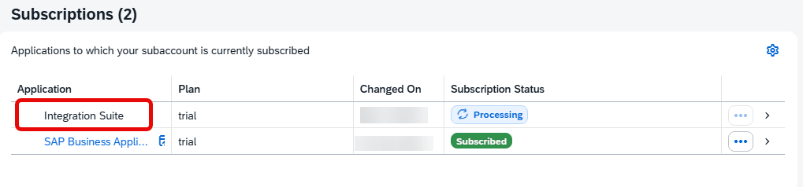
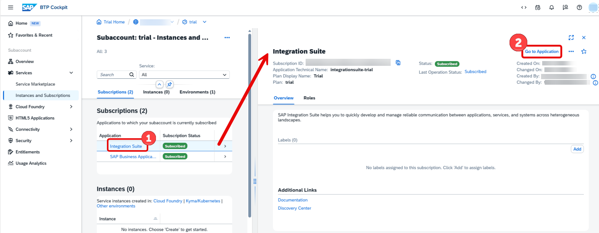

# Subscribe to SAP Integration Suite

This guide explains how to subscribe to the SAP Integration Suite service in an SAP BTP Trial subaccount.

---

## Step 1: Open the Trial Subaccount

Log in to SAP BTP Cockpit and navigate to your Trial Subaccount.

Verify that the subaccount is active and accessible.



---

## Step 2: Open Instances and Subscriptions

From the navigation panel, select:

**Services → Instances and Subscriptions**

This page displays all service subscriptions available in the selected subaccount.



---

## Step 3: Create a Subscription

Click the **Create** button located in the upper-right corner.

The **New Instance or Subscription** dialog box will appear.


---

## Step 4: Select Integration Suite

In the dialog:

- Select **Integration Suite** from the Service dropdown.
- Select **trial** as the Plan.
- Click **Create**.

SAP will begin provisioning the Integration Suite subscription.


---

## Step 5: Wait for Provisioning

The subscription status will initially display:

```text
Processing
```

Provisioning may take several minutes.



---

## Step 6: Verify Subscription Status

Refresh the page periodically until the subscription status changes to:

```text
Subscribed
```

This indicates that the Integration Suite tenant has been successfully provisioned and is ready for use.


---

## Step 7: Launch Integration Suite

Click **Integration Suite** from the subscription list.

The details panel opens on the right side.

Click **Go to Application**.

isor
- Open Connectors
- Trading Partner Management

---

## Next Steps

1. Assign Integration Suite role collections.
2. Enable Cloud Integration capability.
3. Create an Integration Package.
4. Create your first iFlow.
5. Deploy and test the integration flow.
