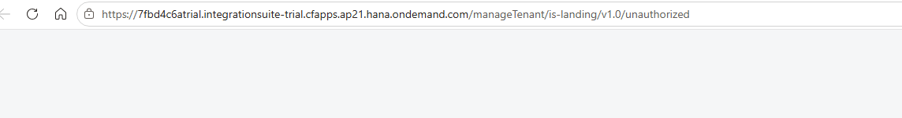
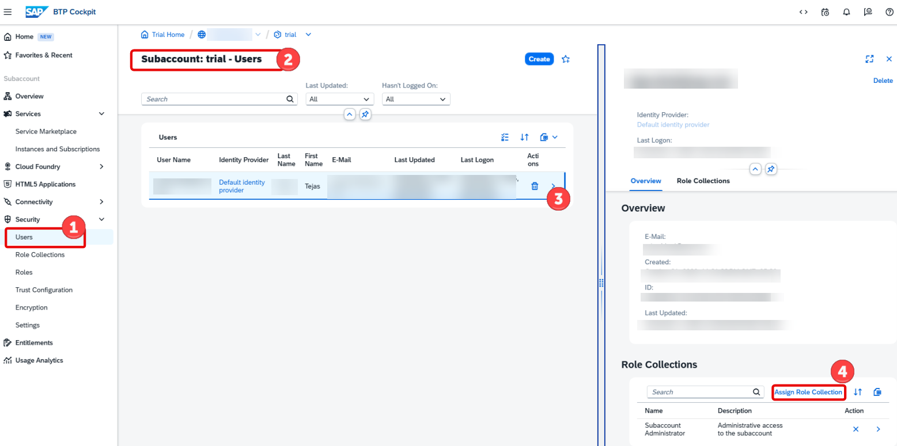
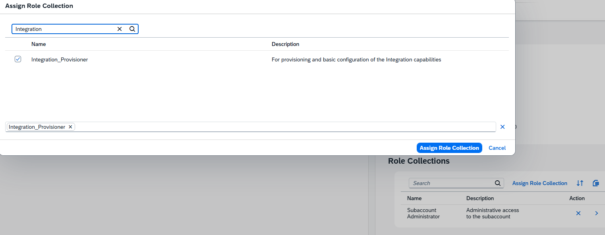
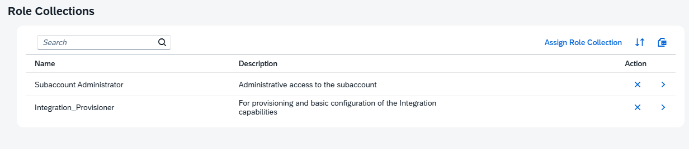

# Access SAP Integration Suite

This guide explains how to resolve the **Unauthorized** error that may occur when accessing SAP Integration Suite for the first time after subscription activation.

---

## Issue

After subscribing to SAP Integration Suite and clicking **Go to Application**, users may encounter an authorization error similar to the following:




```text
https://<global-account-name>.integrationsuite-trial.cfapps.ap21.hana.ondemand.com/manageTenant/is-landing/v1.0/unauthorized
```

This error usually occurs because the user does not yet have the required SAP Integration Suite role collections assigned.

---

## Root Cause

SAP Integration Suite requires specific role collections before users can access and activate Integration Suite capabilities.

The most important role collection for initial access is:

```text
Integration_Provisioner
```

Without this role collection, SAP Integration Suite displays the **Unauthorized** page instead of the Integration Suite landing page.

---

## Step 1: Navigate to SAP BTP Sub Account

Navigate to:

```text
Security → Users
```

Select your **user** from the list.

Click **Assign Role Collection**.



---

## Step 2: Assign Integration_Provisioner

In the role collection search box, search for:

```text
Integration_Provisioner
```

Select the role collection and click **Assign Role Collection**.



---

## Step 3: Assign Additional Integration Suite Roles

Depending on the capabilities you intend to use, assign the appropriate Integration Suite role collections.

Common role collections include:

```text
Integration_Provisioner
PI_Integrator_Group
AuthGroup_IntegrationDeveloper
APIManagement.Administrator
```

> Note: Available role collections may differ depending on your SAP BTP tenant version and enabled capabilities.

After role assignment, verify that the required role collections appear under your user profile.



Reference:

https://help.sap.com/docs/btp/sap-business-technology-platform/building-roles-and-role-collections-for-applications

---

## Step 4: Refresh User Session

After assigning role collections, SAP BTP may require a new authentication session before the permissions become effective.

Perform a hard refresh, If the Unauthorized page still appears after assigning the required role collections:

Option 1: Close all open tabs, Open a new browser window and sign in again.

Option 2: Open SAP Integration Suite using Incognito Mode/ different browser (Chrome, Edge, Firefox)

This prevents old authentication tokens and cached authorization information from being reused.

---

## Step 5: Launch SAP Integration Suite Again

Navigate to:

```text
Services → Instances and Subscriptions
```

Open the Integration Suite subscription.

Click:

```text
Go To Application
```

The Integration Suite home page should now load successfully.

---
## References

SAP Learning Journey: https://learning.sap.com/courses/administering-sap-integration-suite/setting-up-sap-integration-suite

Working with Role Collections: https://help.sap.com/docs/btp/sap-business-technology-platform/working-with-role-collections
